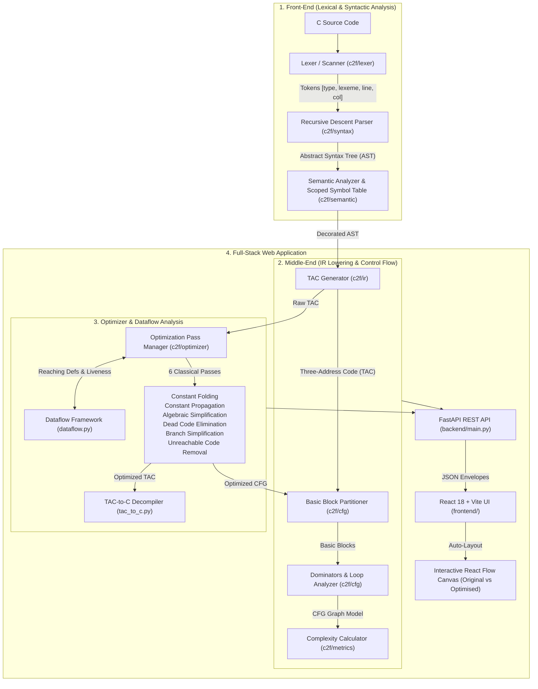

# Code2Flow: Compiler-Based Code-to-Flowchart Generator with Code Optimisation

[](https://www.python.org/)
[](https://fastapi.tiangolo.com/)
[](https://react.dev/)
[](https://vitejs.dev/)
[](https://reactflow.dev/)
[]()

> An end-to-end multi-pass optimizing compiler and interactive visualization suite that translates C source code into Control Flow Graphs (CFG), executes classical dataflow analysis and optimization passes, and renders synchronized, interactive flowcharts with side-by-side comparative visual diffing.

---

## 📖 Overview

**Code2Flow** bridges classical compiler design with interactive software visualization. Built from scratch with modular separation of concerns, the compiler parses a substantive subset of the C programming language, lowers it into normalized Three-Address Code (TAC), computes dominance frontiers and natural loop back-edges, applies iterative dataflow optimizations, and renders interactive, auto-layout flowcharts.

### 🌟 Key Highlights
- **From-Scratch Compiler Pipeline**: Custom hand-written lexer and recursive-descent parser with precedence climbing (no external parser generators like Lex/Yacc or ANTLR).
- **Normalized Intermediate Representation (IR)**: Three-Address Code with guaranteed stable instruction IDs for 1:1 optimization diffing.
- **Advanced Graph-Theoretic CFG Analysis**: Basic block partitioning, dominator tree calculation, immediate dominators ($idom$), loop header and back-edge detection, and McCabe's Cyclomatic Complexity calculation ($V(G) = E - N + 2$).
- **Multi-Pass Dataflow Optimization Suite**: 6 classical optimization passes powered by Reaching Definitions and Live Variable dataflow solvers.
- **Decompilation (TAC $\to$ C)**: Reconstructs optimized, clean C code from optimized TAC instructions.
- **Interactive React Flow UI**: Custom flowchart node geometry (process rectangles, decision diamonds, I/O parallelograms, loop header highlights), Dagre auto-layout, resizable split-pane layout, line-by-line editor highlighting, and step-by-step optimization audit logs.
- **100% Test Coverage**: **236 automated unit and end-to-end integration tests** validating every compiler invariant.

---

## 🏛 Architecture & Compiler Pipeline



---

## 👥 Module Ownership & Engineering Team

The project follows strict modular separation specified in [CONTRACTS.md](CONTRACTS.md):

| Member | Primary Module & Responsibilities | Core Files & Tests |
|---|---|---|
| **Raghav Bajaj** | **Middle-End, CFG, Metrics & API Wiring**<br>Repository skeleton, scoped symbol table (`c2f/semantic`), AST-to-TAC lowering (`c2f/ir`), basic block partitioner (`c2f/cfg`), dominator tree & loop back-edge detection (`c2f/cfg/loops.py`), cyclomatic complexity calculator (`c2f/metrics`), pipeline wiring (`c2f/pipeline.py`), FastAPI backend (`backend/main.py`), and Samples 20–39. | `c2f/semantic/`<br>`c2f/ir/`<br>`c2f/cfg/`<br>`c2f/metrics/`<br>`backend/main.py`<br>`test_semantic_*.py`<br>`test_ir_*.py`<br>`test_cfg_*.py` |
| **Kushan** | **Front-End (Lexical & Syntactic Analysis)**<br>Lexer with line/col tracking (`c2f/lexer`), recursive-descent parser with precedence climbing (`c2f/syntax`), AST node hierarchy, AST-to-JSON serialization, and Samples 01–19. | `c2f/lexer/`<br>`c2f/syntax/`<br>`test_lexer_*.py`<br>`test_syntax_*.py` |
| **Ishani** | **Optimization Engine & Dataflow Solver**<br>Optimization pass manager (`manager.py`), reaching definitions solver (`dataflow.py`), 6 optimization passes, TAC interpreter (`interpreter.py`), TAC-to-C emitter (`tac_to_c.py`), and Samples 40–59. | `c2f/optimizer/`<br>`fixtures/tac/`<br>`test_optimizer_*.py`<br>`test_e2e_ishani.py` |
| **Sneh** | **User Interface & Visual Flowcharting**<br>React 18 + Vite UI, custom React Flow shapes (`FlowNode.jsx`), Dagre auto-layout (`autoLayout.js`), tabbed SidePanel (Tokens, AST, TAC, OptLog, Metrics), ErrorPanel, and Samples 60–79. | `frontend/src/`<br>`components/`<br>`autoLayout.js`<br>`client.js` |

---

## ⚡ Core Compiler Features

### 1. Lexical & Syntactic Analysis
- **Token Coverage**: Keywords (`if`, `else`, `while`, `for`, `do`, `switch`, `case`, `default`, `return`, `break`, `continue`), literals (integers, floats, escape sequences), arithmetic/logical/relational operators, and delimiters.
- **Precedence Climbing**: Correctly builds AST hierarchy honoring operator precedence (e.g., `*` over `+`, nested logical `&&`/`||`).
- **Dangling-Else Resolution**: Automatically binds `else` to the nearest open `if` statement.

### 2. Intermediate Representation (Three-Address Code)
- Flattened instruction set: `assign`, `binop`, `unop`, `label`, `goto`, `if_false`, `if_true`, `call`, `return`, `array_load`, `array_store`.
- **Stable Instruction IDs**: Instruction IDs are strictly immutable across optimization passes, enabling 1:1 diffing between original and optimized code.

### 3. Control Flow Graph & Graph Algorithms
- **Basic Block Partitioner**: Partitions linear TAC into maximal single-entry, single-exit basic blocks.
- **Node Classification**:
  - `start` / `end`: Entry and exit terminal nodes (pill shape).
  - `process`: Sequential computations and statements (rectangle).
  - `decision`: Branch conditions ending in `?` with `TRUE` and `FALSE` outgoing edges (diamond/hex shape).
  - `io`: Dedicated blocks performing `printf` / `scanf` operations (cyan parallelogram).
- **Dominator Tree Analysis**:
  - Computes dominator set $Dom(n)$ where $B_0 \in Dom(n), \forall n$.
  - Computes immediate dominators ($idom(n)$).
- **Loop & Back-Edge Detection**:
  - Identifies natural loop back-edges: an edge $u \to v$ where $v$ dominates $u$.
  - Marks target node $v$ as `is_loop_header = true` (styled with purple border).
- **McCabe's Cyclomatic Complexity**: Computes $V(G) = E - N + 2$.

### 4. Six Classical Optimization Passes
1. **Constant Folding**: Evaluates constant arithmetic, relational, and logical expressions at compile time ($2 \times 3 \to 6$). Handles divide-by-zero safely without compiler crashes.
2. **Constant Propagation**: Inter-statement propagation using Reaching Definitions analysis.
3. **Algebraic Simplification**: Identity replacements ($x \times 1 \to x$, $x + 0 \to x$, $x \times 0 \to 0$, $x - 0 \to x$, $x / 1 \to x$).
4. **Dead Code Elimination (DCE)**: Deletes dead stores and unreferenced variables.
5. **Branch Simplification**: Evaluates constant branch conditions (`if (1)` or `if (0)`), eliminating dead branches and unconditional jumps.
6. **Unreachable Code Removal**: Traverses the CFG from entry to prune basic blocks disconnected from the control graph.

---

## 🚀 Quickstart Guide

### Prerequisites
- **Python**: Version `3.11+`
- **Node.js**: Version `18+` (with `npm`)

---

### Step 1: Clone Repository
```bash
git clone https://github.com/RaghavDied/code2flow.git
cd code2flow
```

---

### Step 2: Start the Backend API (FastAPI)
```powershell
# Navigate to backend
cd backend

# Create virtual environment (optional but recommended)
python -m venv .venv
.venv\Scripts\activate      # On Linux/macOS: source .venv/bin/activate

# Install dependencies
pip install -r requirements.txt

# Launch FastAPI development server
uvicorn main:app --reload --port 8000
```
- **Backend API URL**: `http://localhost:8000`
- **Interactive Swagger Documentation**: [http://localhost:8000/docs](http://localhost:8000/docs)
- **API Endpoints**:
  - `POST /api/tokens`: Token stream generation
  - `POST /api/ast`: Abstract Syntax Tree JSON
  - `POST /api/generate`: TAC, CFG blocks, edges, and cyclomatic complexity
  - `POST /api/optimize`: Multi-pass optimized TAC, optimized CFG, audit log, and decompiled C code

---

### Step 3: Start the Frontend UI (React + Vite)
In a new terminal window:
```powershell
# Navigate to frontend
cd frontend

# Install npm dependencies (if not already installed)
npm install

# Start Vite development server
npm run dev
```
- **Web Application URL**: [http://localhost:5173](http://localhost:5173)

---

## 🖥 Application Interface & Usage

1. **Source Code Editor**: Type or paste any C function into the left panel, or select from pre-loaded samples.
2. **Generate Flowchart**: Click **▶ Generate Flowchart** to parse, lower to TAC, and display the baseline Control Flow Graph.
3. **Run Optimiser**: Click **⚡ Run Optimiser** to run all 6 optimization passes, view side-by-side CFG comparisons, and observe node reduction in real time.
4. **Interactive Resizing**: Drag the vertical splitters with your mouse to customize the width of the editor, flowchart canvas, and inspector panel.
5. **Inspector Tabs**:
   - `Tokens`: Inspect lexer output with token types, lexemes, and coordinates.
   - `AST`: Expandable visual JSON tree of the syntax hierarchy.
   - `TAC`: Normalized Three-Address Code with operand mappings.
   - `OptLog`: Step-by-step audit trail showing every optimization pass and instruction replacement (`before -> after`).
   - `Metrics`: Nodes, edges, decisions, loop count, and Cyclomatic Complexity ($V(G)$).

---

## 🧪 Testing & Verification

The test suite contains **236 automated tests** ensuring end-to-end correctness across all compiler components.

```powershell
# Run the entire test suite from root
python -m pytest

# Run with verbose output
python -m pytest -v

# Run specific module test suites
python -m pytest backend/tests/test_cfg_builder.py backend/tests/test_cfg_metrics.py
python -m pytest backend/tests/test_optimizer_passes.py backend/tests/test_optimizer_dataflow.py
python -m pytest backend/tests/test_e2e_raghav.py

# Run frontend production build test
npm --prefix frontend run build
```

> 📄 For the comprehensive test matrix, category-by-category edge cases, and faculty demonstration walkthroughs, consult **[TEST_SUITE_AND_EDGE_CASES_SPECIFICATION.md](TEST_SUITE_AND_EDGE_CASES_SPECIFICATION.md)**.

---

## 📂 Repository Layout

```
code2flow/
├── backend/
│   ├── main.py                     # FastAPI application routes & CORS configuration
│   ├── requirements.txt            # Python dependencies (fastapi, uvicorn, pydantic, pytest)
│   ├── c2f/
│   │   ├── common/                 # Diagnostic and error envelope models
│   │   ├── lexer/                  # Lexer implementation & Token definitions
│   │   ├── syntax/                 # Recursive-descent parser & AST models
│   │   ├── semantic/               # Scoped symbol table & semantic validation
│   │   ├── ir/                     # Three-Address Code data model & AST lowering
│   │   ├── cfg/                    # Basic blocks, dominator analysis & loop detector
│   │   ├── metrics/                # Cyclomatic complexity calculator
│   │   ├── optimizer/              # 6 passes, dataflow framework, interpreter & emitter
│   │   └── pipeline.py             # Live compiler pipeline orchestration
│   └── tests/                      # Pytest unit & integration test suite (207 tests)
│       └── fixtures/               # Golden fixture payloads & test cases
├── frontend/
│   ├── index.html                  # HTML entry point with project title
│   ├── package.json                # React, Vite, React Flow, Dagre dependencies
│   ├── vite.config.js              # Vite bundler configuration & dev server proxy
│   └── src/
│       ├── App.jsx                 # Main application workspace & resizable layout
│       ├── api/client.js           # REST API client
│       ├── components/
│       │   ├── CodeEditor.jsx      # CodeMirror 6 C source editor
│       │   ├── Flowchart.jsx       # React Flow container with controls & minimap
│       │   ├── FlowNode.jsx        # Custom node shapes (process, decision, io, start/end)
│       │   ├── SidePanel.jsx       # Inspector panel (Tokens, AST, TAC, OptLog, Metrics)
│       │   ├── Toolbar.jsx         # Action buttons (Generate, Optimize, Samples)
│       │   └── ErrorPanel.jsx      # Diagnostic error and warning console
│       └── layout/autoLayout.js    # Dagre graph hierarchy layout engine
├── samples/                        # 35+ C sample test programs covering every feature & edge case
├── CONTRACTS.md                    # Canonical architectural API contracts & schemas
├── pytest.ini                      # Pytest configuration with backend path resolution
└── README.md                       # Master project documentation
```

---

## 📜 Architectural Contracts & Design Rules

All components strictly adhere to [CONTRACTS.md](CONTRACTS.md):
- **Universal Error Envelope**: Every HTTP response uses a standardized envelope format with HTTP 200:
  ```json
  {
    "ok": true,
    "errors": [],
    "warnings": [],
    "data": { ... }
  }
  ```
- **Separation of Concerns**: Middle-end, front-end, optimizer, and UI communicate strictly through serializable data contracts.
- **Stable Instruction Identifiers**: Enables seamless diffing between pre- and post-optimization flowcharts.

---

## 🎓 Academic Review & Demonstration Samples

Recommended sample programs in `samples/` for live project demonstrations:
- **`samples/42_worked_example.c`**: Demonstrates the full optimization cascade (constant folding $\to$ constant propagation $\to$ dead code elimination $\to$ branch simplification), dropping from 7 to 4 nodes.
- **`samples/06_while_loop.c`**: Demonstrates natural loop recognition, loop header identification, and directed back-edges.
- **`samples/22_nested_while_break.c`**: Demonstrates nested loops and direct break edge routing.
- **`samples/24_switch_fallthrough.c`**: Demonstrates switch-case jump tables with intentional fallthrough semantics.
- **`samples/44_scanf_io.c`**: Demonstrates dedicated I/O node classification for `printf` and `scanf`.
